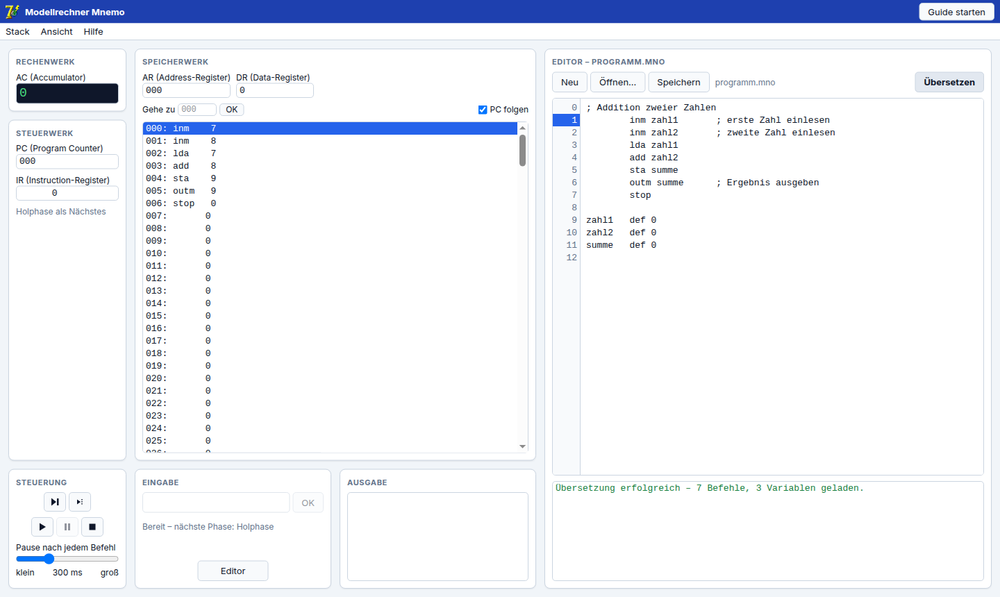
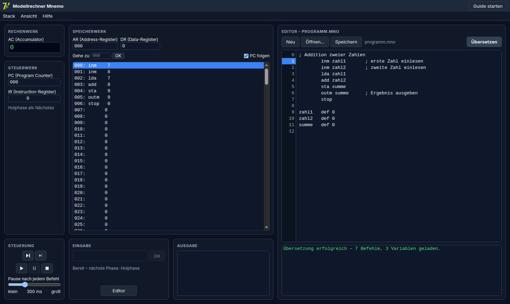
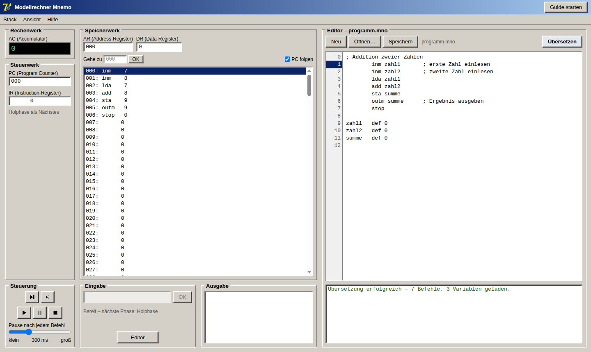
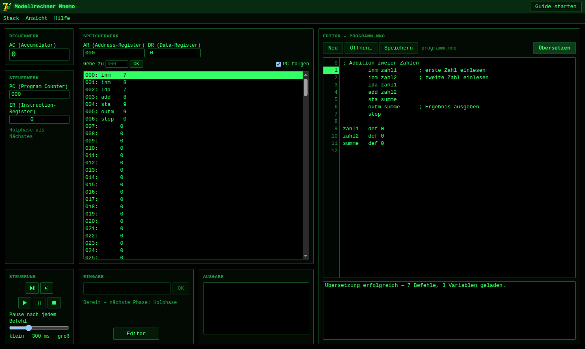

# Modellrechner MNemo – Web-Version

Nachbau des Unterrichtsprogramms **MNemo 3.2** (Modellrechner mit Assembler) als Webapp im Browser, ohne Installation und ohne Server-Backend.



| Dunkel | Klassisch | Terminal |
|---|---|---|
|  |  |  |

## Funktionen

- **Rechenwerk, Steuerwerk, Speicherwerk und Stack** wie im Original: 256 Speicherzellen à 16 Bit, Register AC, PC, IR, AR, DR sowie Stack mit SP/BP
- **Assembler** mit allen 56 Befehlen des Originals (`lda` … `divb`), `DEF`, `EQUAL`, Sprungmarken und `;`-Kommentaren
- Fehlermeldungen und Hinweise wie im Original, Zeilennummern ab 0. Ein Klick auf die Meldung springt zur Zeile.
- **Ablaufsteuerung:** Einzelschritt, Phasen-Schritt (Holen → Dekodieren → Ausführen), Start, Pause, Reset und einstellbare Pause nach jedem Befehl
- Das **Speicherwerk** scrollt in sich, dazu „Gehe zu“ für eine Adresse und „PC folgen“
- **Editor** mit Zeilennummern, Öffnen/Speichern von `.mno`-Dateien und Strg+Enter zum Übersetzen. Der Quelltext bleibt im Browser gespeichert.
- **Guide** („Guide starten“): eine interaktive Tour, die ein Beispielprogramm Schritt für Schritt vorführt
- **Hilfe:** Befehlssatz des Originals und „Fehler melden“ (öffnet ein neues [GitHub-Issue](https://github.com/tinkeredu/gismnemo/issues))
- Steuerwerk (PC, IR) und AR/DR-Register lassen sich unter „Ansicht“ einblenden (standardmäßig aus)
- **Skins** unter „Ansicht“: Automatisch (folgt Hell/Dunkel des Systems), Hell, Dunkel, Klassisch (Windows-Look) und Terminal

## Beispielprogramm

```asm
; Addition zweier Zahlen
        inm zahl1       ; erste Zahl einlesen
        inm zahl2       ; zweite Zahl einlesen
        lda zahl1       ; AC := zahl1
        add zahl2       ; AC := AC + zahl2
        sta summe
        outm summe      ; Ergebnis ausgeben
        stop

zahl1   def 0
zahl2   def 0
summe   def 0
```

„Übersetzen“ lädt das Programm in den Speicher. Danach mit „Start“ oder schrittweise ausführen. Bei `inm` wartet der Rechner auf das Eingabefeld (gelb markiert).

## Befehlsübersicht

| Gruppe | Befehle |
|---|---|
| Laden/Speichern | `lda` `sta` `ldas` `stas` `ldab` `stab` `spbp` `bpsp` |
| Arithmetik | `add` `sub` `neg` `inc` `dec` `adds` `subs` `addb` `subb` `mul` `muls` `mulb` `div` `divs` `divb` |
| Logik | `and` `or` `xor` `shl` `shr` `ands` `andb` `ors` `orb` `xors` `xorb` |
| Stack | `psh` `pop` `pshm` `popm` `pshb` `popb` |
| Ein-/Ausgabe | `inm` `outm` `ins` `outs` `inb` `outb` |
| Sprünge | `jmp` `jms` `jpl` `jze` `jnm` `jnp` `jnz` `jsr` `rtn` `stop` |

Die Endung `s` adressiert relativ zum Stack Pointer, `b` relativ zum Base Pointer. Details stehen in der App unter Hilfe → Befehlssatz.

## Lokal starten

Benötigt [Node.js](https://nodejs.org) ≥ 22.12.

```sh
npm install
npm run dev      # Entwicklungsserver auf http://localhost:5173
```

Statische Version bauen:

```sh
npm run build    # Ergebnis in dist/ (relative Pfade)
npm run preview  # gebaute Version lokal ansehen
```

Den Ordner `dist/` kann man auf jeden Webspace legen, z. B. GitHub Pages oder den Schulserver. Über `file://` (Doppelklick auf `index.html`) funktioniert er nicht, weil Browser dort Module blockieren.

## Entwicklung

```sh
npm test         # Assembler-/CPU-Tests (Vitest)
npm run lint     # oxlint
npm run build    # Typecheck + Produktionsbuild
```

| Pfad | Inhalt |
|---|---|
| `src/core` | Befehlssatz, Assembler und Rechner (UI-unabhängig, getestet) |
| `src/app` | React-Oberfläche: Panels, Editor, Menüs, Guide, Skins |
| `public/docs` | Befehlssatz (HTML des Originals) |

Technik: React 19, TypeScript, Vite, Tailwind CSS 4.

Vom Original lag kein Quellcode vor. Das Verhalten (Speicherlayout, Fehlertexte, Darstellung negativer Zahlen usw.) wurde deshalb am Original-Programm unter Wine nachgemessen.
